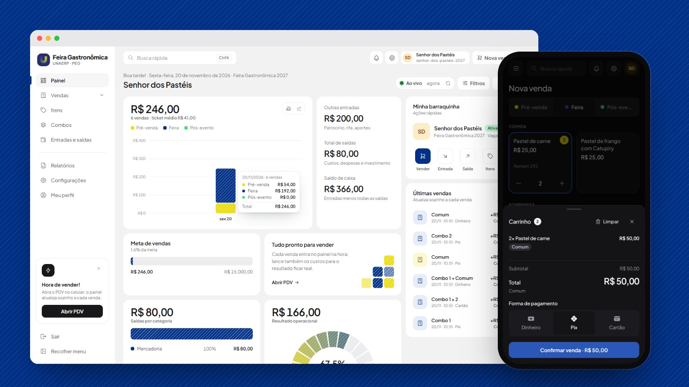

<h1 align="center">
    
</h1>

<p align='center'>
  
  
  
</p>

## 💻 Projeto

**Feira Gastronômica UNAERP** é o sistema de vendas e caixa das barraquinhas da Feira Gastronômica da UNAERP (Projeto PEG). A coordenação cria cada edição da feira, abre as vagas, gera os acessos das equipes e acompanha vendas, saídas e resultados de todas as barraquinhas em tempo real. Cada barraquinha cadastra seus itens e combos, vende pelo PDV no celular, lança entradas e saídas e exporta os próprios relatórios, sem nunca ver os dados das outras.



### ✨ Principais Funcionalidades

- 🛒 **PDV no celular**: o operador só toca nos itens; o sistema reconhece sozinho Comum ou Combo N e aplica o desconto mais vantajoso para o cliente
- ⚙️ **Checkout personalizável**: cada barraquinha escolhe as formas de pagamento aceitas, a já marcada, o canal padrão, itens em grade ou lista, calculadora de troco, chave Pix com botão de copiar e confirmação antes de registrar
- 📊 **Painéis em tempo real**: vendas por dia e por canal, saídas por categoria, saúde financeira, meta de vendas e últimas vendas, atualizados sozinhos a cada venda
- 💰 **Entradas e saídas**: lançamentos com comprovante, saldo de caixa, resultado operacional e margem de cada barraquinha e da feira inteira
- 📑 **Relatórios**: vendas detalhadas, resumo de vendas, entradas e saídas, fechamento financeiro e comparativo de barraquinhas, em XLSX, CSV e PDF, com filtros por período, canal, pagamento e tag
- 🗂️ **Várias edições**: feiras independentes, duplicação de uma edição para a próxima e comparação entre feiras
- 🔐 **Isolamento entre barraquinhas**: toda consulta é filtrada pela barraquinha da sessão; link alterado responde acesso negado e fica na auditoria
- 👤 **Perfil e fotos**: foto do usuário e da barraquinha, recortadas e reduzidas no próprio navegador antes do envio
- 🌗 **Tema claro e escuro**: português e inglês, telas de 360 px a 1920 px e navegação com pré-carregamento das telas

## 📦 Instalação e Execução

### Pré-requisitos

- PHP 8.2 ou superior, com as extensões `pdo_mysql`, `mbstring`, `fileinfo` e `zip`
- Composer 2
- Node.js 20.19 ou 22.12 ou superior, e npm
- MySQL 8 ou MariaDB 10.4 ou superior (o XAMPP já traz PHP e MariaDB)

### Passos de Instalação

```bash
# Clone o repositório
git clone <url-do-repositorio> unaerp

# Entre no diretório do projeto
cd unaerp

# Instale as dependências do PHP e do front
composer install
npm install

# Crie o arquivo de ambiente e a chave da aplicação
cp .env.example .env
php artisan key:generate

# Crie o banco "feira_gastronomica" (utf8mb4) no MySQL/MariaDB
# e ajuste DB_* e APP_URL no .env

# Crie as tabelas e carregue as feiras de demonstração
php artisan migrate --seed

# Compile o front (ou "npm run dev" durante o desenvolvimento)
npm run build

# Execute o projeto
php artisan serve
# ou aponte o DocumentRoot do Apache (XAMPP) para a pasta public/
```

### Acessos de demonstração

| Perfil | Usuário | Senha |
| --- | --- | --- |
| Coordenação (admin) | `coordenacao` | `feira2027` |
| Barraquinha 2027 | `senhor-dos-pasteis-2027`, `crepeuna-2027`, `pizzarito-2027`... | `feira2027` |

A senha vem de `FEIRA_SENHA_DEMO` no `.env`. A **Feira 2026** (encerrada) traz os totais do anexo da especificação: R$ 164.172,67 em vendas e resultado de R$ 21.674,75 (margem de 13,2%). A **Feira 2027** (aberta) tem 12 vagas, itens, combos e algumas vendas.

### Testes

```bash
# SQLite em memória
php vendor/bin/phpunit

# MySQL/MariaDB (use um banco só para testes)
DB_CONNECTION=mysql DB_DATABASE=feira_gastronomica_testes php vendor/bin/phpunit

# Tipos do front
npx tsc --noEmit
```

## 🚀 Deploy

O servidor (InfinityFree) não roda `composer`, `npm` nem `artisan`, então o projeto sobe pronto por FTP:

```bash
# Gera a branch prod (código + vendor sem dev + public/build) e envia por FTP
bash scripts/publicar-prod.sh --push
```

- O banco tem só tabelas (sem views, triggers nem functions) e é criado importando um dump pelo phpMyAdmin.
- O `.env` do servidor é criado uma vez, à mão, por FTP.
- As fotos enviadas ficam em `public/fotos/`, que precisa aceitar escrita pelo PHP e não é tocada pelo deploy.

## 🧭 Decisões da Especificação

| Ponto em aberto | Decisão adotada |
| --- | --- |
| Admin registra vendas? | Não. Consulta e corrige (cancela com motivo); o PDV é da barraquinha. |
| Controle de estoque | Opcional por item: mostra "Restam N" e "Esgotado", sem bloquear a venda. |
| Pagamento e taxa de cartão | Dinheiro, Pix e Cartão; a taxa de cartão entra como despesa. |
| Pré-venda | Registrada no PDV pelo canal Pré-venda, com preço próprio por item. |
| Desconto de combo | Preço fechado ou percentual; a tela calcula o outro valor. |
| Item em mais de um combo | Maior desconto para o cliente; combo mais caro que a soma avulsa nunca é aplicado. |
| Vários operadores | Um login por barraquinha; cada venda grava o operador. |
| Modo offline | Não implementado; cada tela do PDV baixa poucos KB. |

## 📄 Licença

Projeto acadêmico da UNAERP (Projeto PEG), de uso interno da Feira Gastronômica. Todos os direitos reservados.
